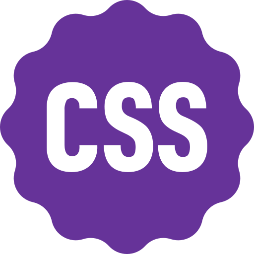
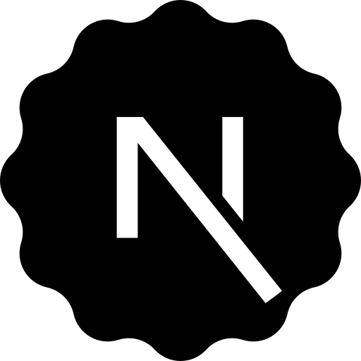

  
  <h1> MahdiDevRoom </h1>
  

    It’s time to begin again. 
    The door opens 🚪
  

---

  <h3> Skills </h3>

  
  
  
  
  
  
  
  
  
  
  
  
  

---

  <h3> Social </h3>

- Instagram: [@DevRoomGram](https://instagram.com/DevRoomGram)
- Telegram: [@DevRoomChannel](https://t.me/MahdiDevChannel)

---